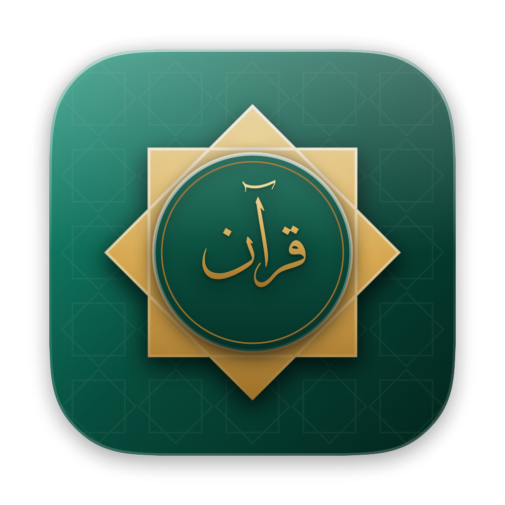

# Quran Reader HD for macOS

**صدقة جارية — Sadaqa Jariyah on behalf of Mohamad Koussa and Dima Ghannoum and their families.**

A native SwiftUI Quran reader for macOS 14+



Requires **macOS 26 or later**: the interface uses Apple's Liquid Glass (floating glass playback dock and
page scrubber, glass study header, tinted-glass opening page). The icon is drawn in code by
`scripts/make-icon.swift` (emerald glass, gold Rub el Hizb, «قرآن» in Thuluth) and packaged by `make-app.sh`.

## Build

```bash
./make-app.sh          # → build/Mushaf.app (release, ad-hoc signed)
open build/Mushaf.app
```

Only the Command Line Tools are needed. The script builds against the macOS 26.5 SDK when Xcode isn't
selected, because the macOS 27 CLT SDK needs Xcode's SwiftUI macro plugin for `@State`.

## Features

| Quran Reader HD | Here |
|---|---|
| Madani mushaf pages, turned like a book | 604 page images, single page or two-page spread, slide transition, ←/→ keys |
| Tap and hold an ayah for the menu | Click to select, right-click for the ayah menu, double-click to recite |
| Verse-by-verse recitation, Abdul Basit | EveryAyah audio with 5 reciters, Abdul Basit Murattal by default; basmala played before each surah |
| Repeat each verse / repeat selection | Repeat each ayah or the range up to ∞, Play To start/stop ayah |
| Play to end of surah / whole Quran | Scope: this ayah, to end of surah, or continue through the Quran |
| Highlight while reciting | Playing ayah is highlighted, and the reader follows it to the next page |
| Translation and tafsir | Saheeh International, Pickthall, Hamidullah (FR), Al-Jalalayn and Al-Muyassar (AR) in the inspector |
| Translation/tafsir-only mode | "Translation & Tafsir" mode lists the surah as text |
| Notes and bookmarks with export | Per-ayah notes (tinted on the page), page bookmarks, JSON export/import (File menu) |
| iCloud last-page sync | Last page is mirrored to `NSUbiquitousKeyValueStore` (works only once signed with an iCloud entitlement) |

## Added from reviewing Quran Reader HD Testers Feedback

- **Search**: Arabic (no diacritics needed) or translation, with word suggestions and "Show more results".
- **Juz' & Hizb index**: all 240 rub' al-hizb with their opening words; the hizb is also shown in the title bar.
- **Page slider**: jump anywhere, showing page, surah, juz' and hizb.
- **Tassel bookmark**: a ribbon at the top of each page that toggles its bookmark. Bookmarks have titles,
  can be renamed, and sort by page or date.
- **Sticky notes**: yellow tabs in the page margin, stacking into a menu when one line has several notes.
- **Recitation**: repeat up to ∞, and *Play To* with a chosen start and stopping ayah.
- **Study view**: show Arabic, translation or both, plus optional tafsir.
- **Copy & share**: an ayah with its translation and a "Surah X : Verse Y : Page Z" citation.
- **Export**: notes & bookmarks as HTML or JSON, or emailed as plain text through your default mail app (a `mailto:` link, so Outlook works too).
- **Display**: brightness control, swipe-to-turn on/off, and Classic, Coloured or Night pages.
- **Help sheet** (⌘?) and **deep links**: `mushaf://ayah/2/255`, `mushaf://page/50`, `mushaf://surah/18`.

The **Coloured** theme imitates the original's colour mushaf on the open page images: parchment, a
gold-and-green frame, and every name of Allah in red. The red is placed by aligning quran.com's
per-word text with the glyph boxes in `ayahinfo_1024.db`. One quran.com word can cover several glyphs
(pause marks, "بَعْدَ مَا", a glued saktah ۜ). Any ayah whose count doesn't match is left uncoloured
rather than coloured wrongly.

Not carried over: the page-curl animation, Facebook/Twitter/QamarDeen sharing (services gone or
replaced by the share sheet), and iCloud sync of notes (needs a signed build with an iCloud entitlement).
The IPA's own page images, audio and translation databases are Batoul Apps' assets and are **not** used.

## Languages, translations and tafsir

The whole interface switches between **English, Français and العربية** (globe button in the toolbar,
Help → Language, or the opening page). Arabic lays the interface out right-to-left; the mushaf spread and
page arrows keep book order. Switching language also picks that language's default translation and tafsir.

- Translations: English (Saheeh International, Pickthall), French (Hamidullah, Montada Islamic Foundation,
  Rashid Maash).
- Tafsir: Arabic (Al-Muyassar, Al-Jalalayn), English (Ibn Kathir abridged, Ma'arif al-Qur'an, Tazkirul Quran).
  **No French tafsir is openly available** from these sources, so the French UI says so and offers English
  or Arabic tafsir.
- Reciters: Abdul Basit (Murattal, Mujawwad), Al-Husary, Al-Minshawi, Mishary Alafasy, **Salah Bukhatir**.

## Where things come from and where they are stored

Nothing is bundled in the app. Each item is downloaded the first time it's needed, then read from disk:

| What | Downloaded from | Cached in `~/Library/Application Support/MushafMac/` |
|---|---|---|
| Mushaf page images (604 PNGs, 1024×1656) | this repo: `pages/` (online) or the `pages-v1` release zip (install) | `pages/` when installed, `~/Library/Caches/MushafMac/pages` when online |
| Ayah positions on the pages | this repo: `data/ayahinfo_1024.db` | `data/ayahinfo_1024.db` |
| Recitation, one MP3 per ayah | `everyayah.com/data/<reciter>/` | `audio/<reciter>/SSSAAA.mp3` |
| Arabic text, translations, Arabic tafsir, surah/juz data | `api.alquran.cloud` | `text/`, `data/meta.json` |
| French translations, English tafsir, word data | `api.quran.com` | `text/`, `words/` |
| Notes and bookmarks | — | `library.json` |

The **mushaf pages are not shipped in the app or the DMG**. On first run the app offers to download all
604 pages (≈75 MB) in one go from this repository's `pages-v1` release (`QuranReaderHD-Pages.zip`), or to read
online, in which case each page is fetched from `pages/` in this repository as it is opened and kept in
`~/Library/Caches/MushafMac/pages`. Installed pages live in `~/Library/Application Support/MushafMac/pages`
and can be removed again (File menu, or Page Appearance). `./make-dmg.sh` builds `build/QuranReaderHD.dmg`.

## Data sources (downloaded on demand, cached in `~/Library/Application Support/MushafMac`)

- Page images and ayah coordinates (`ayahinfo_1024.db`): originally from `android.quran.com`, the CDN of the
  open-source Quran for Android app; now hosted in this repository (`pages/`, `data/`).
- Recitation audio: `everyayah.com`.
- Text, translations, tafsir, surah and juz metadata: `api.alquran.cloud`.

Before you ship this, check each provider's terms and consider hosting the data yourself. The page images
reproduce the King Fahd Complex Madani mushaf.

## Layout

```
Sources/MushafMac/
  Storage.swift         AyahKey, cache paths, remote URLs, downloader
  GlyphDB.swift         SQLite word boxes → hit-testing and highlight rectangles
  TextLibrary.swift     surah metadata, text editions, search
  PageWords.swift       word-to-glyph alignment for colouring the name of Allah
  UserLibrary.swift     notes, bookmarks, last page, export/import, iCloud KV
  AudioController.swift recitation queue, repeats, prefetching
  AppModel.swift        navigation state, page image cache
  MushafReader.swift    page and spread views with the highlight canvas
  ContentView.swift, SidebarView.swift, AudioBar.swift, AyahInspector.swift, TextModeView.swift
```
